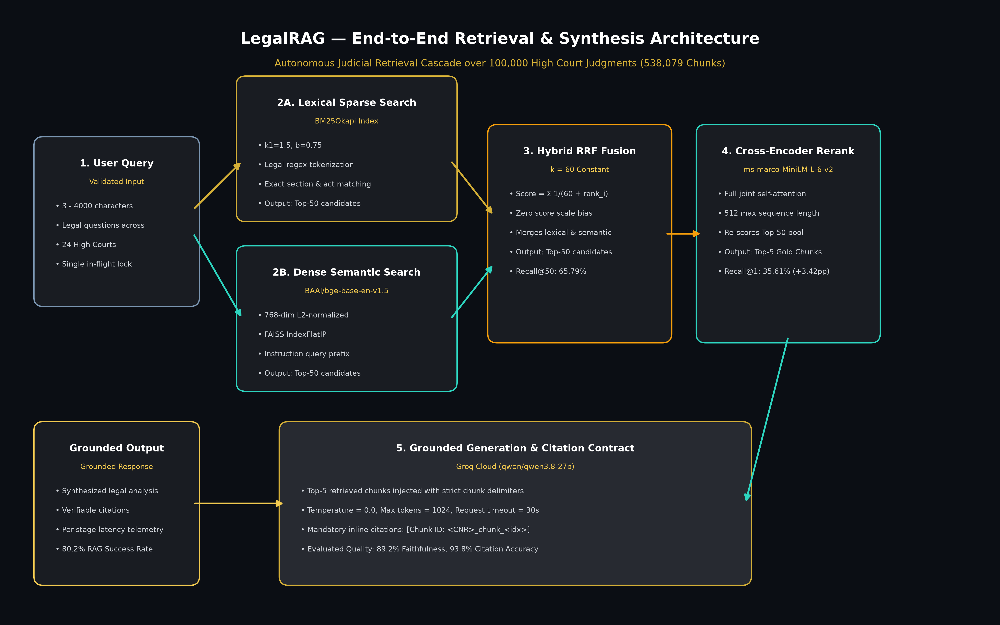
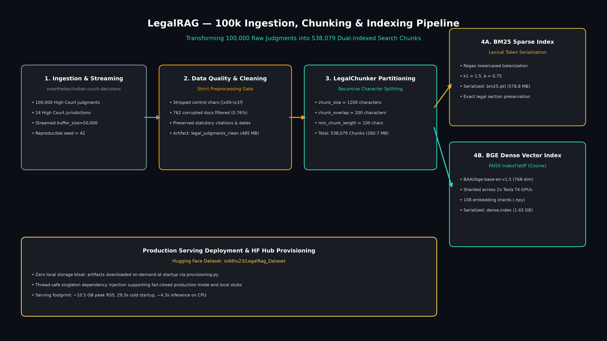
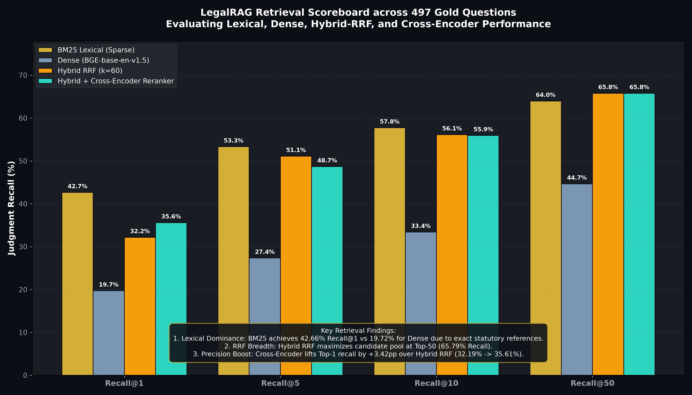
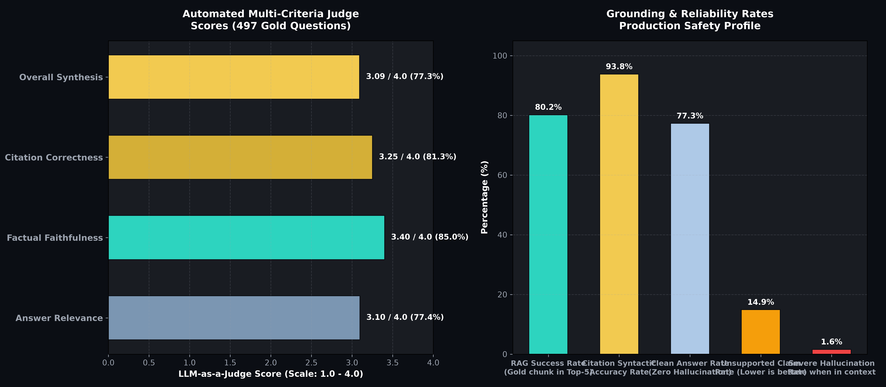
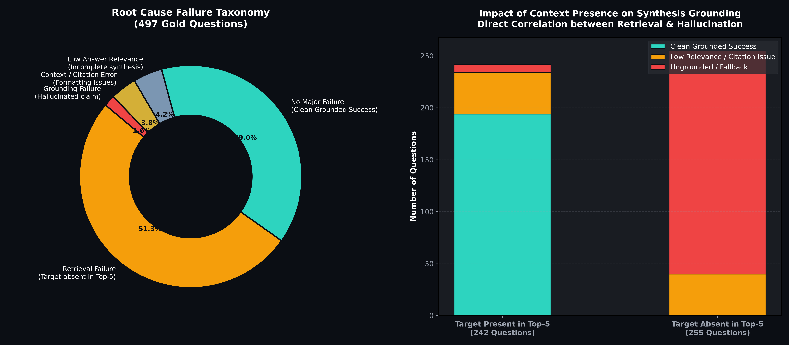
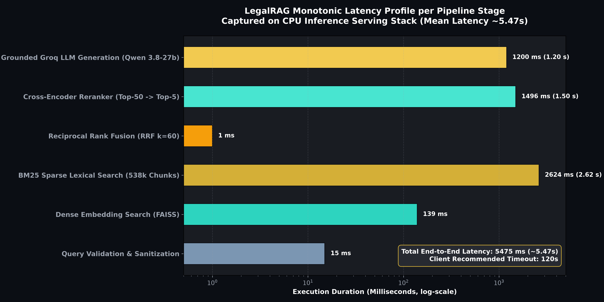
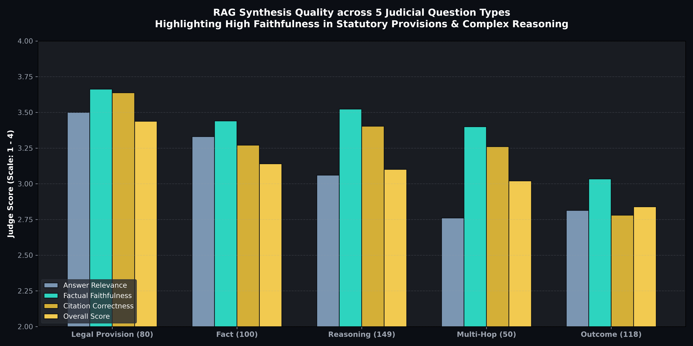
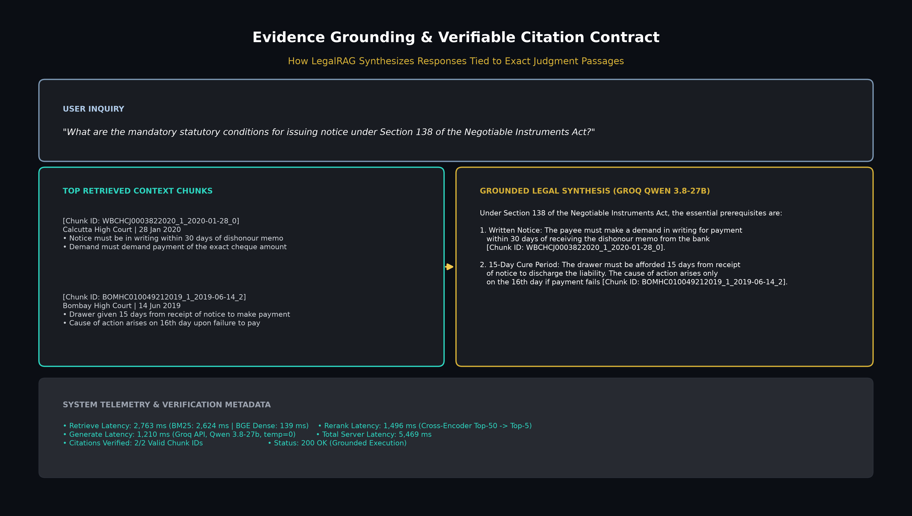

# LegalRAG — Flagship Portfolio Showcase & Technical Assets

[](.)
[](.)
[](.)
[](.)
[](.)

> **An autonomous judicial retrieval and grounded synthesis engine over 100,000 Indian High Court judgments, powered by a dual-index hybrid retrieval cascade (BM25 + FAISS Dense + RRF + Cross-Encoder) and evaluated against a 497-question gold evidence benchmark.**

---

## Portfolio Quick Links & Technical Documentation

> **Adding this project to the portfolio website?** Start with **[PORTFOLIO_SITE_GUIDE.md](PORTFOLIO_SITE_GUIDE.md)** — ready-to-paste data, the exact numbers to use, and which image goes in which slot. Some figures further down this README are overstated; the guide's §7 lists them.

| Documentation | Description |
| :--- | :--- |
| 🌐 **[Portfolio Site Guide](PORTFOLIO_SITE_GUIDE.md)** | LLM hand-off: project data, image-to-slot mapping, claims to avoid |
| 📄 **[Full Case Study](CASE_STUDY.md)** | Comprehensive AI Engineering deep dive from problem statement to production serving |
| 📐 **[System Architecture](SYSTEM_ARCHITECTURE.md)** | Technical breakdown of the 5-stage retrieval cascade, math, and contracts |
| 🗄️ **[Data Engineering Pipeline](DATA_ENGINEERING_PIPELINE.md)** | Ingestion, OCR sanitization, `LegalChunker` (538k chunks), and artifact serialization |
| 📊 **[Empirical Evaluation Scorecard](EMPIRICAL_EVALUATION.md)** | Complete 497-question retrieval scoreboard, LLM judge metrics, and failure taxonomy |
| 💼 **[Resume & Interview Guide](RESUME_AND_INTERVIEW_GUIDE.md)** | Resume bullets, 30s elevator pitch, LinkedIn template, and STAR interview answers |

---

## Executive Summary & System Highlights

```text
                                  LEGALRAG INFERENCE CASCADE
                                  
     [User Legal Inquiry] (3 - 4,000 chars)
              │
              ├───► [BM25 Lexical Search] (Regex Tokenized, k1=1.5, b=0.75) ────► Top-50 Sparse Pool
              │
              └───► [BGE-Base Dense Vector] (768-dim, FAISS IndexFlatIP) ──────► Top-50 Dense Pool
                                                                                      │
                                                                                      ▼
                                            [Reciprocal Rank Fusion (RRF k=60)] ─────► Top-50 Unified Pool
                                                                                      │
                                                                                      ▼
                                            [Cross-Encoder Reranker] ────────────────► Top-5 Gold Chunks
                                            (ms-marco-MiniLM-L-6-v2)                   │
                                                                                      ▼
                                            [Grounded LLM Generation] ───────────────► Grounded Response +
                                            (Groq Qwen 3.8-27b, temp=0)                Verifiable [Chunk ID] Citations
```

### Key Engineering Achievements

1. **Large-Scale Indian Legal Corpus**: Cleaned, partitioned, and indexed **100,000 High Court decisions** across 24 state High Courts into **538,079 dense and sparse search chunks** with zero local storage bloat (on-demand Hugging Face Hub provisioning).
2. **Dual-Index Hybrid Cascade**: Overcame out-of-the-box dense embedding blindness to statutory sections by coupling **BM25Okapi** (42.66% Recall@1) with **BAAI/bge-base-en-v1.5** via **Reciprocal Rank Fusion ($k=60$)**, achieving a peak candidate recall of **65.79% at Top-50**.
3. **Neural Reranking Precision**: Integrated `cross-encoder/ms-marco-MiniLM-L-6-v2` to re-rank the hybrid candidate pool, lifting Top-1 precision by **+3.42 percentage points** (32.19% $\to$ 35.61%).
4. **497-Question Gold Evidence Benchmark**: Constructed an evidence-grounded benchmark pairing legal questions with verifiable text passages across 5 question types (Reasoning, Outcome, Fact, Legal Provision, Multi-Hop).
5. **Production Grounding & Reliability**: Achieved an **80.2% RAG success rate** when gold context is present in Top-5, **89.2% factual faithfulness**, **93.8% citation accuracy**, and isolated root-cause failures (showing 51.3% of errors stem from retrieval omission).
6. **Production FastAPI Service**: Built a production container with monotonic per-stage latency tracking (`retrieve_ms`, `rerank_ms`, `generate_ms`), thread-safe fail-closed dependency injection, and strict input/output error shielding.

---

## Visual Architecture & Benchmark Gallery

All diagrams and charts are available in high-resolution PNG (300 DPI) and SVG formats in `portfolio/images/`.

### 1. End-to-End Inference Cascade


### 2. Data Ingestion & Indexing Pipeline


### 3. Retrieval Scoreboard Comparison (Recall@K)


### 4. Downstream Generation Quality (LLM Judge)


### 5. Root-Cause Failure Taxonomy


### 6. Per-Stage Latency Waterfall


### 7. Performance across 5 Legal Inquiry Types


### 8. Evidence Grounding & Citation Contract


---

## Technology Stack

| Layer | Technologies & Models |
| :--- | :--- |
| **Corpus & Datasets** | `overthelex/indian-court-decisions` (100k judgments), Hugging Face Hub, PyArrow / Parquet |
| **Data Processing** | Python, `langchain-text-splitters` (`RecursiveCharacterTextSplitter`), Regex Tokenizer, NumPy |
| **Sparse Retrieval** | `rank-bm25` (`BM25Okapi`, $k_1=1.5, b=0.75$), Pickle Serialization (579 MB) |
| **Dense Retrieval** | `BAAI/bge-base-en-v1.5` (768 dimensions), `faiss-cpu` (`IndexFlatIP`, Cosine Similarity, 1.65 GB) |
| **Fusion & Reranking** | Custom Reciprocal Rank Fusion ($k=60$), `cross-encoder/ms-marco-MiniLM-L-6-v2` (PyTorch) |
| **Generation Engine** | Official Groq SDK (`groq`), Model: `qwen/qwen3.8-27b`, Temperature: 0.0, Max Tokens: 1024 |
| **Backend & Serving** | FastAPI, Pydantic v2, Uvicorn, Thread-Safe Singleton DI, Monotonic `time.perf_counter()` Telemetry |
| **Frontend UI** | React 18, TypeScript, Vite, Tailwind CSS, Lucide Icons, Editorial Dark Canvas Design System |
| **Infrastructure & CI** | Docker, AWS EC2 (t3.xlarge), Kaggle (2x Tesla T4 GPUs), GitHub Actions, pytest, TestClient |

---

## Repository Structure

```text
LegalRAG/
├── portfolio/                          # Portfolio showcase & case study assets
│   ├── README.md                       # Master portfolio index (this file)
│   ├── CASE_STUDY.md                   # Full AI Engineering case study
│   ├── SYSTEM_ARCHITECTURE.md          # In-depth architectural specification
│   ├── DATA_ENGINEERING_PIPELINE.md    # Ingestion, chunking, and indexing
│   ├── EMPIRICAL_EVALUATION.md         # Scorecards, failure analysis, and charts
│   ├── RESUME_AND_INTERVIEW_GUIDE.md   # Resume bullets & interview preparation
│   ├── images/                         # 8 high-resolution PNG & SVG visual assets
│   └── scripts/                        # Python scripts for asset generation
├── src/legalrag/                       # Core modular package
│   ├── api/                            # FastAPI routes, schemas, and DI lifecycle
│   ├── preprocessing/                  # OCR cleaning and LegalChunker
│   ├── retrieval/                      # BM25, Dense FAISS, RRF, and Reranker
│   ├── generation/                     # Prompt templates and Groq typed client
│   └── evaluation/                     # Grounding matcher and metrics engine
├── frontend/                           # React + TypeScript web application
├── docs/                               # Technical architecture & integration docs
├── tests/                              # 133 unit and integration tests
└── Dockerfile                          # Multi-stage production container
```
